# n8n AI Customer Support Automation

A production-grade, multi-channel **AI customer support system** built entirely with [n8n](https://n8n.io) and PostgreSQL + pgvector.

It turns an inbound support message into a grounded, validated answer or a human escalation, backed by persistent memory, real RAG, deterministic policy rules, idempotent persistence, ticket management and structured analytics. Every piece is a real, importable n8n workflow — nothing here is pseudo-code or mock nodes.

```
Customer → Webhook → Validation → Security → Idempotency → Customer → Memory
        → AI Agent → Sentiment/Priority → RAG → Response → Validation
        → Router → Response / Escalation → Ticket → Logging
```

---

## Table of contents

- [Features](#features)
- [Architecture](#architecture)
- [Project structure](#project-structure)
- [Prerequisites](#prerequisites)
- [Installation](#installation)
  - [1. PostgreSQL + pgvector](#1-postgresql--pgvector)
  - [2. Load the database](#2-load-the-database)
  - [3. n8n setup](#3-n8n-setup)
  - [4. Credentials](#4-credentials)
  - [5. Environment variables](#5-environment-variables)
  - [6. Import the workflows](#6-import-the-workflows)
  - [7. RAG ingestion](#7-rag-ingestion)
  - [8. Activate and test](#8-activate-and-test)
- [API reference](#api-reference)
- [How it works](#how-it-works)
- [Testing](#testing)
- [Troubleshooting](#troubleshooting)
- [Security](#security)
- [Limitations](#limitations)
- [Future improvements](#future-improvements)
- [License](#license)

---

## Features

**Multi-channel intake**
- One webhook accepts Website, WhatsApp, Telegram, Email, Slack, Instagram and Facebook Messenger payloads.
- Every channel is normalized into a single internal envelope: `source, customer_id, conversation_id, message_id, message, metadata`.
- The AI pipeline is written **once** and reused by all channels — no per-channel duplication.

**Validation, security and idempotency**
- Strict input validation (JSON shape, message length, IDs, timestamp, channel) with structured 400 errors.
- Sanitization of control characters, URL metacharacters and credential-like patterns; prompt-injection keyword flagging.
- Idempotent processing keyed on `message_id + source` (deterministic FNV-1a content hash stored alongside).
- Duplicate requests return the cached response; message/ticket creation is idempotent.

**Customers, conversations and memory**
- Get-or-create customers with channel-scoped identity, first/last interaction and metadata.
- Persistent conversation history in PostgreSQL with a bounded LLM window plus **automatic summarization** of long conversations.

**AI classification**
- OpenAI Chat Model (via n8n credentials) with structured-output chains.
- Intent classification across 15 intents; sentiment and priority detection.
- LLM output is parsed and validated in code with deterministic fallbacks (malformed output never crashes the pipeline).

**Deterministic policy engine**
- Critical decisions are rule-based and never depend on the LLM alone:
  - low confidence → escalation
  - critical / urgent issue → immediate escalation
  - human request → escalation
  - refund above `REFUND_APPROVAL_THRESHOLD` → manual approval
  - angry / frustrated / repeated complaints → higher priority
  - strong RAG result → automated response
  - weak RAG result / RAG miss → clarification or escalation

**RAG with PostgreSQL + pgvector**
- Real vector retrieval: documents → chunking → embeddings → pgvector, then similarity search with configurable thresholds.
- Separate knowledge-base ingestion workflow (webhook `POST /kb/ingest` or `KB_SOURCE_URL` fetch).
- The AI is grounded: it must not invent prices, policies, delivery dates, refunds, order status, product specs or company information.

**Response validation**
- Deterministic checks for relevance, factual grounding, unsupported claims, prompt leakage, secrets, length and business-rule compliance.
- One automatic regeneration with the issues fed back into the prompt; a second failure escalates to a human.

**Human escalation and tickets**
- Escalation for low confidence, critical issues, human requests, unsupported questions, repeated AI failures, angry customers, sensitive account issues, manual refunds and failed validation.
- Ticket lifecycle: `open`, `pending`, `assigned`, `waiting_customer`, `resolved`, `closed`.
- Ticket management API with `create`, `update`, `assign`, `resolve`, `reopen`, `get`, `list`.

**Observability**
- Every processed message writes an analytics event (intent, sentiment, priority, RAG hit, validation, duration, status).
- Dedicated Error Trigger workflow logs structured workflow errors.

---

## Architecture

```mermaid
flowchart LR
    C["Customer"]
    W["Webhook Intake"]
    V["Validate & Normalize"]
    SEC["Security Sanitization"]
    IDEM["Idempotency Check"]
    CL["Customer Lookup"]
    MEM["Conversation Memory"]
    AI["AI Intent Classification"]
    SEN["Sentiment & Priority"]
    PE["Deterministic Policy Engine"]
    RAG["RAG Retrieval"]
    GEN["Grounded Response Generation"]
    VAL["Response Validation"]
    ROUTE["Router"]
    ESC["Escalation & Tickets"]
    PERSIST["Persist & Analytics"]
    RESP["Response to Channel"]

    C --> W --> V --> SEC --> IDEM
    IDEM --> CL --> MEM --> AI --> SEN --> PE
    PE -->|"escalate"| ESC
    PE -->|"respond/clarify"| RAG
    RAG --> GEN --> VAL --> ROUTE
    ROUTE -->|"valid"| PERSIST
    ROUTE -->|"invalid x2"| ESC
    ESC --> PERSIST
    PERSIST --> RESP
```



**Workflow layers**

| Layer | Sub-workflow | Responsibility |
|------|-------------|----------------|
| Intake | `customer-support.json` (main) | Webhook, validation, idempotency, routing |
| Identity | `subflows/customer-lookup.json` | Get-or-create customer (SQL upsert) |
| Memory | `subflows/conversation-memory.json` | Conversation upsert, recent messages, summarization |
| Intelligence | `subflows/ai-classification.json`, `subflows/sentiment-analysis.json` | Intent, sentiment, priority via LLM chains |
| Policy | (Code node in main) | Deterministic rules engine |
| Retrieval | `subflows/rag-query.json` | pgvector similarity search + thresholding |
| Generation | `subflows/response-generation.json` | Grounded AI Agent (memory + grounding tool) |
| Validation | `subflows/response-validation.json` | Deterministic response checks |
| Escalation | `subflows/escalation.json` | Reasons, ticket creation, handoff message |
| Persistence | `subflows/finalize-and-respond.json` | Message/ticket/analytics writes, idempotency completion |

**Reusable sub-workflows.** Every concern above is an independent workflow invoked through **Execute Sub-workflow** nodes using `source: localFile`. Because sub-workflows return the output of their last executed node, mutually exclusive branches inside them need no Merge node, which keeps execution linear and avoids the classic n8n "Merge waits for all inputs" hang.

---

## Project structure

```
customer-support-ai-automation-n8n/
├── README.md
├── LICENSE
├── CHANGELOG.md
├── .gitignore
├── .env.example
├── workflows/
│   ├── customer-support.json              # Main intake & routing
│   ├── knowledge-base-ingestion.json      # RAG ingestion (documents -> pgvector)
│   ├── ticket-management.json             # Ticket CRUD API
│   ├── error-handler.json                 # Global error logging (Error Trigger)
│   └── subflows/
│       ├── customer-lookup.json
│       ├── conversation-memory.json
│       ├── ai-classification.json
│       ├── sentiment-analysis.json
│       ├── rag-query.json
│       ├── response-generation.json
│       ├── response-validation.json
│       ├── escalation.json
│       └── finalize-and-respond.json
├── database/
│   ├── schema.sql                         # Full PostgreSQL + pgvector schema
│   └── seed.sql                           # Idempotent seed data
├── docs/
│   ├── ARCHITECTURE.md
│   ├── ENVIRONMENT.md
│   ├── TESTING.md
│   ├── SECURITY.md
│   └── TROUBLESHOOTING.md
├── examples/
│   ├── webhook.request.json               # Main webhook payload
│   ├── channels/                          # Per-channel payloads
│   ├── ingestion.request.json             # KB ingestion payload
│   └── tickets/                           # Ticket API payloads
└── tests/
    ├── scenarios.md                       # Test scenarios & expected results
    ├── fixtures/                          # Payload fixtures per scenario
    ├── validate_workflows.mjs             # JSON/structure validator
    └── run_tests.sh                       # Runs the validator + doc checks
```

---

## Prerequisites

- **n8n** (self-hosted) — tested with n8n 1.x. Community or paid edition.
- **PostgreSQL 13+** with the **pgvector** extension (`vector`).
- An **OpenAI** API key (chat + embeddings). Any provider supported by an n8n Chat Model sub-node can be substituted for the chat calls; the embeddings model must match the `VECTOR(n)` dimension in `schema.sql` (1536 for `text-embedding-3-small`).
- **Node.js 18+** only if you want to run the local validation script in `tests/`.

---

## Installation

### 1. PostgreSQL + pgvector

Install PostgreSQL and pgvector. On Debian/Ubuntu:

```bash
# Install PostgreSQL (example for Ubuntu 22.04)
sudo apt-get update
sudo apt-get install -y postgresql postgresql-contrib

# Install pgvector
sudo apt-get install -y postgresql-14-pgvector
```

Create the database and user:

```sql
CREATE USER n8n WITH PASSWORD 'change-me';
CREATE DATABASE ai_customer_support OWNER n8n;
GRANT ALL PRIVILEGES ON DATABASE ai_customer_support TO n8n;
```

### 2. Load the database

```bash
psql -h localhost -U n8n -d ai_customer_support -f database/schema.sql
psql -h localhost -U n8n -d ai_customer_support -f database/seed.sql
```

The seed script is idempotent (safe to run repeatedly). Seed chunk embeddings are zero-vectors so the script runs without an API key — **re-ingest the knowledge base** after setup so real vectors replace them (see [RAG ingestion](#7-rag-ingestion)).

### 3. n8n setup

```bash
# Pull the project to the n8n host
git clone https://github.com/ibam28/customer-support-ai-automation-n8n.git /opt/n8n-ai-customer-support

# Copy the sub-workflow base path into the n8n process environment
# (or set it in the n8n .env file inside the n8n user folder)
echo 'SUBWORKFLOW_BASE_PATH=/opt/n8n-ai-customer-support/workflows/subflows' >> ~/.n8n/.env

# Start n8n
N8N_ENCRYPTION_KEY='your-encryption-key' npx n8n start
```

> The `SUBWORKFLOW_BASE_PATH` variable must point to the `workflows/subflows` directory on the n8n host. Every Execute Sub-workflow node resolves it as a local file, so no workflow IDs need to be wired by hand.

### 4. Credentials

Create these credentials in **n8n → Credentials** (or connect them once per node):

| Credential | Nodes that use it | Notes |
|-----------|------------------|-------|
| **OpenAI API** | Chat Models, Embeddings nodes | Model names come from `CHAT_MODEL` / `EMBEDDING_MODEL`. Alternatively leave the API key blank and set `OPENAI_API_KEY` in the n8n environment — n8n connects automatically. |
| **Postgres** | All Postgres / Vector Store nodes | Point at `ai_customer_support`, the `n8n` user, and the schema `public`. |

> Every credential reference in the imported workflows appears as an unset placeholder. n8n will prompt you to select the corresponding credential the first time you run a node.

### 5. Environment variables

Copy `.env.example` and review the tunable thresholds:

```bash
cp .env.example .env
```

Key variables (all optional — sensible defaults are baked into the workflows):

| Variable | Default | Purpose |
|----------|---------|---------|
| `SUBWORKFLOW_BASE_PATH` | — | Absolute path to `workflows/subflows` on the n8n host |
| `WEBHOOK_PATH` | `customer-support` | Main webhook URL suffix |
| `CHAT_MODEL` | `gpt-4o-mini` | Chat model for classification / sentiment / generation |
| `EMBEDDING_MODEL` | `text-embedding-3-small` | Embeddings model (must match `VECTOR(n)`) |
| `AI_CONFIDENCE_THRESHOLD` | `0.6` | Below this confidence → escalate |
| `REFUND_APPROVAL_THRESHOLD` | `100` | Refunds ≥ this amount need manual approval |
| `RAG_TOP_K` | `4` | Chunks retrieved per query |
| `RAG_STRONG_THRESHOLD` | `0.5` | Score ≥ this → strong RAG hit (automated answer) |
| `RAG_SIMILARITY_THRESHOLD` | `0.3` | Score ≥ this → weak hit (clarify/escalate) |
| `CONTEXT_MESSAGE_LIMIT` | `10` | Recent messages injected into the LLM |
| `CONTEXT_SUMMARIZE_THRESHOLD` | `8` | Auto-summarize when window reaches this size |
| `RESPONSE_MAX_LENGTH` | `500` | Max validated response length |
| `RETRY_LIMIT` | `1` | Regeneration attempts before escalation |
| `KB_SOURCE_URL` | — | Optional document source for ingestion |
| `KB_CHUNK_SIZE` / `KB_CHUNK_OVERLAP` | `800` / `100` | Chunking parameters |

### 6. Import the workflows

1. In n8n, choose **Workflows → Create Workflow → ⋯ → Import from File**.
2. Import **all** files from `workflows/` and `workflows/subflows/`.
3. Select an OpenAI credential on the four model/embedding nodes and a Postgres credential on all database nodes (n8n flags them as needing credentials).
4. Set `SUBWORKFLOW_BASE_PATH` so the Execute Sub-workflow nodes resolve their local files.
5. In each workflow's **Settings**, point the **Error Workflow** at `AI Support - Error Handler`.
6. Activate `customer-support`, `knowledge-base-ingestion`, `ticket-management` and `error-handler` (toggle **Active**).

### 7. RAG ingestion

With the ingestion workflow active, send documents:

```bash
curl -X POST http://localhost:5678/webhook/kb/ingest \
  -H 'Content-Type: application/json' \
  -d @examples/ingestion.request.json
```

or set `KB_SOURCE_URL` and run the workflow manually — it fetches, chunks, embeds and stores into `document_chunks`.

### 8. Activate and test

Send a test message:

```bash
curl -X POST http://localhost:5678/webhook/customer-support \
  -H 'Content-Type: application/json' \
  -d @examples/webhook.request.json
```

See [examples/](#examples) for realistic payloads and [Testing](#testing) for the full scenario matrix.

---

## API reference

### `POST /webhook/customer-support`

Request body:

```json
{
  "channel": "website",
  "customer_id": "cus_123",
  "conversation_id": "conv_456",
  "message_id": "msg_789",
  "message": "Where is my order?",
  "timestamp": "2026-01-01T12:00:00Z",
  "customer": { "name": "Alex Morgan", "email": "alex@example.com" },
  "metadata": { "order_id": "ORD-1001", "refund_amount": 60 }
}
```

| Field | Type | Required | Notes |
|-------|------|----------|-------|
| `channel` | string | yes | `website` \| `whatsapp` \| `telegram` \| `email` \| `slack` \| `instagram` \| `facebook` (aliases `web`, `chat`, `messenger` map to canonical sources) |
| `customer_id` | string | yes | Channel-scoped customer identifier |
| `conversation_id` | string | yes | Channel-scoped conversation identifier |
| `message_id` | string | yes | Used for idempotency |
| `message` | string | yes | ≤ 4000 chars after sanitization |
| `timestamp` | string | optional | ISO-8601; defaults to now |
| `customer` | object | optional | `name`, `email` used to enrich the customer record |
| `metadata` | object | optional | Free-form; `refund_amount` is used by the policy engine |

Response (automated):

```json
{
  "success": true,
  "source": "website",
  "message_id": "msg_789",
  "conversation_id": "conv_456",
  "customer_id": "cus_123",
  "reply": "Your order is out for delivery and should arrive today.",
  "intent": "order_status",
  "confidence": 0.92,
  "sentiment": "neutral",
  "priority": "normal",
  "requires_human": false,
  "escalated": false,
  "ticket_number": null,
  "ticket_status": null,
  "validated": true
}
```

Invalid input returns `400` with `{ "success": false, "error": { "code": "validation_error", "details": [...] } }`. A duplicate `message_id` returns the cached response from the idempotency store.

### `POST /webhook/kb/ingest`

Ingests `documents` from the body (or fetches `KB_SOURCE_URL` when empty).

### `POST /webhook/tickets`

Ticket management. Actions: `create`, `update`, `assign`, `resolve`, `reopen`, `get`, `list`.

```json
{ "action": "create", "subject": "Refund request", "priority": "high", "customer_id": "..." }
```

---

## How it works

1. **Intake.** The main webhook validates and sanitizes the payload, then derives the idempotency key. A completed key short-circuits with the cached reply; otherwise the key is reserved as `processing`.
2. **Identity & memory.** The customer is upserted, the conversation upserted, and the recent messages loaded. Long windows trigger automatic summarization.
3. **Intelligence.** Two LLM chains produce intent (15 classes) and sentiment/priority. Output is parsed in code with fallbacks.
4. **Policy.** The deterministic engine combines LLM signals with hard rules to pick `respond` / `clarify` / `escalate`. `escalate` leaves immediately to a human.
5. **Retrieval.** The message is embedded and searched against `document_chunks`. Thresholds classify the result as strong / weak / miss.
6. **Generation.** The AI Agent answers strictly from retrieved context + memory summary, with a grounding tool, persistent chat memory and injection-defense instructions. `clarify` mode produces a clarifying question instead.
7. **Validation.** Deterministic checks (length, leakage, secrets, ungrounded claims, refund rule, relevance, false certainty). One regeneration on failure; a second failure escalates.
8. **Finalize.** Messages, conversation state, idempotency completion and analytics are written; the reply is returned.

---

## Examples

Ready-to-send payloads live in `examples/`:

- `examples/webhook.request.json` — main request (single-doc format).
- `examples/channels/*.json` — WhatsApp, Telegram, Email, Slack, Instagram, Facebook variants of the same envelope.
- `examples/ingestion.request.json` — knowledge base ingestion.
- `examples/tickets/*.json` — `create`, `assign`, `resolve`, `reopen`, `get`, `list`.

---

## Testing

`tests/scenarios.md` documents 15 scenarios (FAQ, product question, order status, refund, angry customer, human request, unknown question, low confidence, RAG miss, duplicate message, invalid request, LLM failure, database failure, prompt injection, critical issue) with expected routing and outcomes. Fixtures live in `tests/fixtures/`.

Run the built-in validation suite (requires Node.js):

```bash
cd tests && ./run_tests.sh
```

The validator (`tests/validate_workflows.mjs`) checks that every workflow:

- is valid JSON with unique node `id`s,
- has well-formed `connections` that reference existing nodes and valid connection types,
- only references existing sub-workflow files (`localFile` sources),
- flags undefined `$env.` variables against `.env.example`,
- flags `REPLACE_WITH_` credential placeholders so they are not forgotten.

> The end-to-end AI behaviours (classification quality, RAG hits, escalation routing) require a live n8n, PostgreSQL and an OpenAI key. They are documented as executable manual tests in `tests/scenarios.md` and are not claimed to be automatically verified.

---

## Troubleshooting

See `docs/TROUBLESHOOTING.md` for the full guide. Quick hits:

| Symptom | Fix |
|---------|-----|
| Execute Sub-workflow "File not found" | Set `SUBWORKFLOW_BASE_PATH` to the absolute path of `workflows/subflows` |
| `node could not be found` on import | Your n8n version predates a node type/version; update n8n (1.x) |
| RAG returns nothing | Re-ingest the KB; verify `document_chunks` has real embeddings (not zero vectors) |
| Vector dimension mismatch | `EMBEDDING_MODEL` dimension must equal `VECTOR(n)` in `schema.sql` |
| Duplicates still processed | Ensure `message_id` is unique per logical message per channel |
| Workflow errors aren't logged | Set the Error Workflow on every workflow to `AI Support - Error Handler` and activate it |

---

## Security

- No secrets are hard-coded. All credentials live in n8n Credentials or the environment.
- Webhook input is sanitized (control characters, credential-like patterns) and prompt-injection keywords are flagged.
- Customer messages and retrieved documents are treated as **untrusted data**: the agent is instructed to ignore embedded instructions and never reveal system prompts, keys or internal reasoning.
- Response validation scans for prompt leakage and secret patterns and rejects such responses.
- SQL is fully parameterized (no string-concatenated queries).

See `docs/SECURITY.md` for the threat model and hardening checklist.

---

## Limitations

- Deterministic (heuristic) grounding checks in `response-validation.json` are intentionally conservative; they can produce false positives on long, conversational answers.
- The ticket `assign`/`resolve` actions update `status` but do not yet send notifications to human agents.
- Re-ingesting documents appends new chunk rows; delete old rows first for a clean re-embed (see `docs/ARCHITECTURE.md`).
- The Postgres chat memory table (`n8n_chat_histories`) is managed by n8n; prune it on a retention schedule.
- Embeddings are OpenAI-only by default; swapping providers requires matching the vector dimension.

---

## Future improvements

- Native vector-store tool/retriever wiring on the AI Agent for tool-native RAG.
- Slack/Telegram native trigger nodes per channel (in addition to the unified webhook).
- Agentic tool calling for order lookup, refund execution and password reset.
- Conversation summarization on a scheduled job instead of in-band.
- Webhook HMAC signing / channel secrets for authenticated intake.
- Containerized setup (`docker-compose.yml` with PostgreSQL + pgvector + n8n).
- Ticket SLA timers and escalation notifications.

---

## License

[MIT](LICENSE) — Copyright (c) 2026 **Bambang Saputra Jaya**.
