# Architecture

This document explains how the n8n AI Customer Support Automation project is designed, why it is split the way it is, and how data flows through the system.

## Overview

The system is a pipeline of small, single-responsibility n8n workflows. A top-level intake workflow drives the pipeline by invoking dedicated sub-workflows through **Execute Sub-workflow** nodes. Because a sub-workflow returns the output of its **last executed node**, mutually exclusive branches inside sub-workflows never need to be re-joined — which avoids the classic n8n trap where a **Merge** node (which waits for *all* inputs) hangs a branch that only fires on one side.

```mermaid
flowchart LR
    IN["Webhook: /webhook/customer-support"]
    VN["Validate & Normalize"]
    ID["Idempotency"]
    CL["Customer Lookup"]
    MEM["Conversation Memory"]
    CLS["Intent Classification"]
    SEN["Sentiment & Priority"]
    PE["Policy Engine"]
    RG["RAG Query"]
    GN["Grounded Generation"]
    VL["Response Validation"]
    RT["Router"]
    ESC["Escalation"]
    FN["Finalize & Respond"]

    IN --> VN --> ID --> CL --> MEM --> CLS --> SEN --> PE
    PE -->|"escalate"| ESC
    PE -->|"respond / clarify"| RG --> GN --> VL --> RT
    RT -->|"valid"| FN
    RT -->|"invalid x2"| ESC
    ESC --> FN
```

## Workflow inventory

### Main workflows (in `workflows/`)

| File | Trigger | Purpose |
|------|---------|---------|
| `customer-support.json` | Webhook `{{ $env.WEBHOOK_PATH \|\| 'customer-support' }}` | Orchestrates the full support pipeline |
| `knowledge-base-ingestion.json` | Webhook `kb/ingest` + Manual | Chunk → embed → store knowledge documents |
| `ticket-management.json` | Webhook `tickets` | Ticket CRUD API |
| `error-handler.json` | Error Trigger | Logs failed workflow executions |

### Sub-workflows (in `workflows/subflows/`)

| File | Invoked by | Returns |
|------|-----------|---------|
| `customer-lookup.json` | Main | `{ customer }` (created or existing) |
| `conversation-memory.json` | Main | `{ conversation_id, recent_messages[], summary }` |
| `ai-classification.json` | Main | `{ intent, confidence, raw }` |
| `sentiment-analysis.json` | Main | `{ sentiment, priority, urgency }` |
| `rag-query.json` | Main | `{ rag_status: strong/weak/miss, context, scores }` |
| `response-generation.json` | Main | `{ response }` |
| `response-validation.json` | Main | `{ valid, issues[] }` |
| `escalation.json` | Main | `{ escalated, ticket_number, ticket_status, message }` |
| `finalize-and-respond.json` | Main | `{ success, reply }` |

## Data model

See `database/schema.sql` for the exact DDL. Core tables:

- **customers** — channel-scoped identity, enrichment metadata.
- **conversations** — per conversation_id, summary, status, last activity.
- **messages** — every inbound/outbound message, role, intent, sentiment, response validated flag.
- **documents** / **document_chunks** — knowledge base; chunks are `vector(1536)` with an HNSW cosine index and `metadata` (document_id, chunk_index).
- **tickets** — escalation tickets with lifecycle status and priority.
- **idempotency_keys** — message-level deduplication with status `processing` / `completed`.
- **analytics_events** — per-message observability.
- **n8n_chat_histories** — managed by n8n's Postgres Chat Memory node.

## The pipeline in detail

### 1. Intake, validation, idempotency (main workflow)

1. **Webhook** — unified endpoint for all channels.
2. **Validate & Normalize** — checks channel, IDs, message length, timestamp; normalizes channel aliases; merges a second optional request format into the canonical envelope.
3. **IF (valid?)** — invalid requests receive a structured `400` and stop.
4. **Security sanitization** — strips control characters and URL metacharacters, flags credential-like and injection keywords.
5. **Build Idempotency Key** — deterministic FNV-1a hash of `message_id + source`.
6. **Check Idempotency** — an existing `completed` key returns the cached reply; a `processing` key blocks concurrent duplicates.
7. **Reserve Key** — inserts the key as `processing` with a TTL.

### 2. Identity, memory, intelligence

- **Customer Lookup** — SQL upsert (`INSERT ... ON CONFLICT (customer_id, channel) DO UPDATE`). Returns the canonical customer.
- **Conversation Memory** — upserts the conversation, loads the recent-message window (`CONTEXT_MESSAGE_LIMIT`), and auto-summarizes when the window reaches `CONTEXT_SUMMARIZE_THRESHOLD`.
- **Intent Classification** — a `chainLlm` node with strict JSON schema returns `{intent, confidence, requires_human}`; a Code node parses the output and falls back to `unknown` with a low confidence on any parse failure.
- **Sentiment & Priority** — a second `chainLlm` returns `{sentiment, priority, urgency}` with the same parse/fallback pattern.

### 3. Deterministic policy engine (Code node, main workflow)

Combines LLM signals with hard business rules. The engine can only return three decisions:

- `respond` — continue to RAG + generation.
- `clarify` — produce a clarifying question via the generator.
- `escalate` — leave the pipeline to a human.

Rules that force `escalate` (never left to the LLM):

- confidence < `AI_CONFIDENCE_THRESHOLD`
- intent is `human_agent` / `technical_support`
- `refund_request` with `metadata.refund_amount` >= `REFUND_APPROVAL_THRESHOLD`
- sentiment `angry` or `frustrated`, or a repeated complaint detected in memory
- any critical keywords (`security`, `data breach`, `locked out`, `fraud`, …)
- intent `unrecognized` / `unknown`
- a malformed LLM classification (missing intent/confidence)

### 4. RAG

`rag-query.json` embeds the user message and runs a pgvector similarity search against `document_chunks`. Scores are `[0,1]` (cosine similarity; higher = closer). Thresholds:

| Status | Condition | Behaviour |
|--------|-----------|-----------|
| `strong` | top score >= `RAG_STRONG_THRESHOLD` | Grounded automated answer |
| `weak` | top score >= `RAG_SIMILARITY_THRESHOLD` | Clarify or escalate |
| `miss` | below both | Escalate (cannot answer) |

The `strong`/`weak`/`miss` decision is re-checked by a policy branch *after* RAG, because RAG results may overrule the pre-RAG decision (e.g. a confident question with no knowledge → escalate).

### 5. Generation

`response-generation.json` is an **AI Agent** (Tools Agent) with:

- Chat Model (OpenAI, `CHAT_MODEL`)
- Postgres Chat Memory (session = conversation_id) — n8n manages `n8n_chat_histories`
- a **Code Tool** `policy_lookup` so the agent has a real tool connected (required by the Agent node) and can look up deterministic policy on demand
- a system prompt that grounds every answer in the retrieved context + memory summary and hard-forbids invented facts

In `clarify` mode the same generator produces a focused clarifying question.

### 6. Validation

`response-validation.json` runs **deterministic** checks over the generated text:

- length (min/max)
- relevance overlap with the original question
- ungrounded claims against the retrieved context
- policy compliance (refund threshold, critical/security topics)
- prompt-leakage patterns and secret/credential patterns
- false certainty (`guarantee`, `always`, `definitely`) on non-factual topics

Returns `{ valid, issues[] }`. The main workflow regenerates **once**, feeding the issues back into the generator; a second invalid response escalates.

### 7. Escalation

`escalation.json`:

1. Builds an escalation reason (pre-computed in the main workflow).
2. Looks up an active ticket for the same conversation; reuses it, otherwise creates one.
3. Returns a handoff message to the customer, whose tone depends on sentiment (angry → apologetic + timeframe).

### 8. Finalize & respond

`finalize-and-respond.json` writes the inbound message, the reply, the conversation update, the idempotency completion, and the analytics event, then returns the response envelope.

## Why sub-workflows?

- **Testability** — each stage can be run in isolation from the editor.
- **Reuse** — the same stages serve future channels/triggers.
- **Avoidance of Merge nodes** — each sub-workflow returns its last executed node, so exclusive branches stay linear.
- **Local files, not IDs** — `Execute Workflow` uses `source: localFile` with `workflowPath: ={{ $env.SUBWORKFLOW_BASE_PATH }}/<file>.json`, so imports are self-contained and no hard-coded workflow UUIDs exist anywhere.

## Related documents

- `ENVIRONMENT.md` — full configuration reference.
- `TESTING.md` — how to validate and test.
- `SECURITY.md` — threat model and hardening.
- `TROUBLESHOOTING.md` — known issues and fixes.
